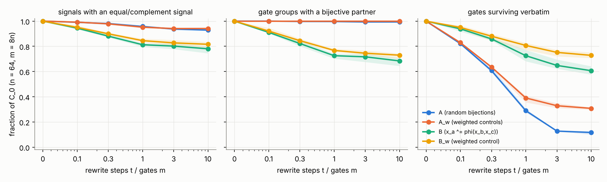
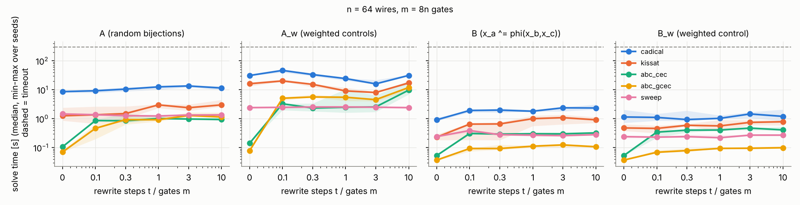
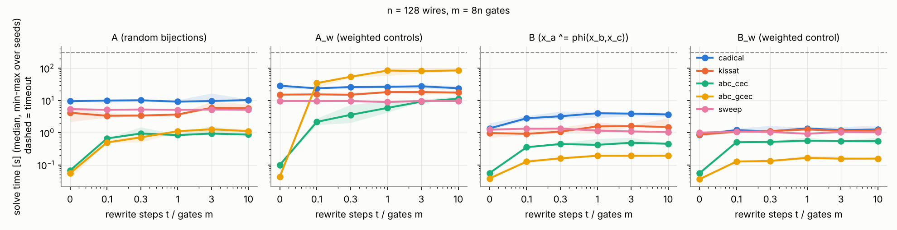
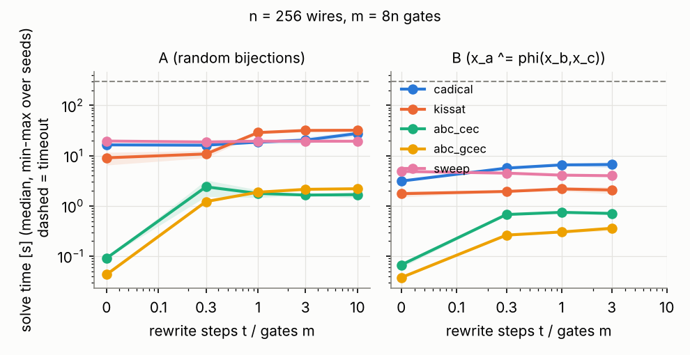

# Random geometric miters: first round of experiments

Draft of 16 November 2026. These are the first-round experiments for the
proposal *Random geometric miters: explanations that are easy to record and
hard to recover*. Code, data and plots are in this repository; how to
reproduce them is at the end.

## Summary

1. **As written, the model's rewriting is almost only "gauge".**
   - Take random 3-bit bijection gates and replace a window of w = 2 gates by
     2 gates with the same function. In 98.2% of windows, every equivalent
     sequence has the same wire triples as the original.
   - The only freedom is to insert h, h⁻¹ on the wires that the two gates
     share.
   - Apart from rare exceptions, C_t therefore keeps the skeleton of C_0, and
     every cut of C_t is a product of local bijections, each on at most 3
     wires, of the same cut of C_0.
   - For pure gauge rewriting, this gives a resolution refutation of constant
     width and size O(m) for *every* t. E4 shows the rare exceptions do not
     change this in practice.
2. **Internal equivalences do not die out.**
   - 74% of windows share a single wire, and the only bijections of one bit
     are identity and NOT.
   - So at t = 10m, 93% of C_0's internal signals still have an equal or
     complementary signal in C_t, and 99% of gate groups have a bijective
     partner.
3. **No instance became hard.**
   - Grid: n ≤ 256 wires, m = 8n gates, t ≤ 10m (t ≤ 3m for B at n = 256),
     four model variants, 3 seeds (2 at n = 256).
   - All 198 miters were solved by every default tool within 300 s. The best
     tool never needed more than 13.4 s on any instance.
   - Running time grows at most mildly with t, and saturates around t ≈ m.
4. **The structure can be recovered without the transcript.**
   - "Relational sweeping" finds bijective relations between gate groups of
     C_0 and C_t by simulation and verifies them with a SAT solver. It solves
     every instance at every t: in 0.2–20 s, growing with n and not with t.
   - This extends SAT sweeping from equal signals to bijectively related
     signal groups.
5. **The richer gate set does not change the outcome.**
   - With CCMR-style gates x_a ^= φ(x_b, x_c), w = 3 windows do allow skeleton
     changes (23% of windows).
   - But the process stalls: at t = 10m, 61% of the gates are still verbatim
     copies of gates in C_0. The instances stay easy.
6. **The weighted variant gives a heavy-tailed degree distribution but no
   hardness.**
   - It makes CDCL slower by a constant factor already at t = 0.
   - It does not make hardness grow with t, and splitting on the
     highest-degree variables does not help (they are not a backdoor).
   - With distance-independent controls, the formula stops looking geometric.
     A distance penalty on light wires (GIRG-like) and controls on only a
     fraction of gates restore it.
7. **Day-10 criterion: not met.**
   - No setting had instances solved within a minute at small t and by no
     tool within an hour at large t.
   - The obstacle is the rewriting process, not the instance size.
   - The rewrite process has to mix. Only then can Q2 hold, and internal
     equivalences are the wrong quantity to count: what matters is how wide the
     correspondences between cuts of C_0 and C_t are.

## Setup

- **Geometry.** n points uniform on the d-torus; d = 2 in this round. The
  radius r is set so that a wire has 8 neighbours on average, and point sets
  are resampled until the neighbour graph is connected. The *local* triples
  are the triples that are pairwise within r.
- **Gate sets.** A gate is (targets T, read-only controls K, table): for
  every value of the controls, a bijection on the target bits.
  - **A**: as in the proposal. A uniform local triple and a uniform
    permutation of {0,1}³.
  - **B**: CCMR-style. x_a ^= φ(x_b, x_c), with {a, b, c} local and φ one of
    the 10 two-input functions that depend on both inputs. This form is
    reconstructed from memory: eprint.iacr.org was not reachable from this
    machine.
  - **A_w**: weighted variant of A. Each wire has a Pareto weight
    (P(W > w) = w^−(β−1), default β = 2.5). A gate gets a control c ∉ T with
    P(c) ∝ W_c, and two permutations π₀, π₁ selected by c.
  - **B_w**: weighted variant of B. x_a ^= φ(x_b, x_c) with a, b local and c
    chosen by weight.
  - Optional knobs: α, a distance penalty (1 + dist/r)^−α; and p_ctrl, the
    fraction of controlled gates.
- **Windows.** Pick a uniform gate, then repeatedly add the first later gate
  that does not commute with the window. Gates commute if they act on
  disjoint wires, or share only control wires, or are XOR gates with the same
  target. The window is convex, and the gates between its members are moved in
  front of it.
- **Replacement.** Uniform among all *other* sequences with the same number of
  gates that compute the same function on the window's wires and use only
  gates of the same gate set.
  - A and A_w, w = 2: exact enumeration, via a 2-gate decomposition algorithm
    over all gate shapes on the window's wires. Each feasible shape is weighted
    by the size of its gauge orbit (`model.decompose2`).
  - B and B_w, w = 3: exhaustive meet-in-the-middle over the gate set on the
    window's wires (`model.equivalent_xor_fast`, with a C kernel).
- **Encoding.** Miter CNF with shared inputs. Each output bit is encoded by
  Tseitin from all prime implicants of the bit and of its negation. Each
  circuit is also written as BLIF for ABC.
- **Tools.**
  - CaDiCaL 3.0.1 and Kissat 4.0.4 (GitHub master), each with defaults and with
    `--congruence=false --sweep=false`.
  - ABC `cec`, and `&cec` on AIGs.
  - Timeouts: 300 s, and 120 s for the no-congruence runs. 4 parallel jobs on a
    4-core machine.

## E0 — validation

`check.py` is independent of the generator: it has its own gate evaluator and
its own commutation test. It checks:
1. Every reordering in the transcript only swaps gates that commute
   semantically, tested exhaustively on their wires.
2. Every window replacement computes the same function, tested exhaustively on
   the window's wires.
3. Replaying the transcript reproduces C_t.
4. C_0 ≡ C_t by brute force (n ≤ 16), or on 10⁴ random inputs.
5. CaDiCaL returns UNSAT.

All 48 small instances pass (4 gate sets × n ∈ {12, 16} × t ∈ {0, m/2, 2m} × 2
seeds). In the negative control, one table entry of C_t is changed. Replay,
simulation, CaDiCaL (SAT) and ABC (counterexample) all catch it. Across all
runs below, no solver ever answered SAT on a miter.

## E1 — what rewrites exist?

1000–2000 random windows per setting (400 for w = 3), from random circuits
with n = 64, m = 512.

| gate set | w | windows with any alternative | … with a different skeleton | remark |
|---|---|---|---|---|
| A | 2 | 100% | **1.85%** | the gauge orbit has (2^k)! elements, k = number of shared wires |
| A_w | 2 | 66% | 0.15% | 41% of windows: gauge controlled by a shared control wire |
| B | 2 | 8.8% | 4.5% | XOR gates are almost rigid at w = 2 |
| B | 3 | 65% | 23% | half of the alternatives only reorder the gates |
| B_w | 2 | 2.4% | 1.3% | |
| B_w | 3 | 57% | 11% | |

Number of wires the two gates of an A window share: 1 wire in 74% of
windows, 2 in 24%, 3 in 2.5%.

Why A is almost gauge-only:
- A generic product of two random bijection gates determines its skeleton
  through its dependency structure.
- A count makes this plausible. A skeleton realises at most about 8!² ≈ 1.6·10⁹
  functions, out of 32! on 5 wires, so two different skeletons almost never
  realise the same function.
- The 1.85% exceptions arise when the first gate's output on a shared wire
  depends only on that wire's input. That wire then acts like a control, and
  the gates can be re-wired, e.g. (18,43,63),(43,52,63) → (18,43,52),(18,43,63).
- w = 3 was not checked exhaustively for A. The counting argument suggests the
  same behaviour.

**Consequence: a bounded-width proof.** For pure gauge rewriting, gate i of C_t
is H_i^out ∘ g_i ∘ (H_i^in)⁻¹. Here H^in and H^out are products of bijections,
one per edge of the dependency graph, and each acts on the wires the edge
carries (≤ 3).
1. Walk through the gates in order. From the relations on gate i's inputs and
   the clauses of g_i and g'_i, derive the relation z_out = H_i^out(y_out).
   This needs ≤ 24 clauses of width ≤ 4 over ≤ 12 variables.
2. Outputs have no outgoing edge, so the final relation is z = y.
3. Together with the miter clauses, this refutes the formula. The refutation
   has constant width and size O(m).

The rare skeleton changes widen individual relations to ≤ 5 wires. E4 shows
that this does not accumulate in practice.

## E2 — what survives? (n = 64, m = 512, 3 seeds)



| gate set | t/m = 0.1 | 1 | 10 |
|---|---|---|---|
| A: equal/complement signals | 0.99 | 0.96 | 0.93 |
| A: groups with bijective partner | 1.00 | 1.00 | 0.99 |
| A: gates verbatim | 0.82 | 0.29 | 0.12 |
| B: equal/complement signals | 0.95 | 0.81 | 0.78 |
| B: groups with bijective partner | 0.91 | 0.73 | 0.68 |
| B: gates verbatim | 0.94 | 0.73 | 0.61 |

All three curves saturate.
- In A, a gauge stays on the edge where it was inserted; it does not propagate.
  A signal loses its equivalent only if the gauge on its outgoing edge mixes
  two or more wires, and a 1-wire gauge is the identity or NOT.
- In B, about 35% of windows have no alternative at all, and half of the
  alternatives are reorderings. So the walk stays close to C_0 even at
  t = 10m.

*Measurement:* 1024 random input patterns. Two different balanced functions
that agree on all of them are possible in principle but unlikely; matches were
not confirmed by SAT.

## E3 — solver hardness against t

Median solve time in seconds over the seeds; m = 8n. All tools ran with
default options and a 300 s timeout. The full tables, including n = 64, are
in [results/tables.md](results/tables.md).





| gate set | n | tool | t/m=0 | t/m=0.1 | t/m=0.3 | t/m=1 | t/m=3 | t/m=10 |
|---|---|---|---|---|---|---|---|---|
| A | 128 | cadical | 9.5 | 9.9 | 10.1 | 9.1 | 9.6 | 10.2 |
| A | 128 | kissat | 4.1 | 3.3 | 3.4 | 3.7 | 5.9 | 5.8 |
| A | 128 | abc_cec | 0.1 | 0.7 | 0.9 | 0.8 | 0.9 | 0.9 |
| A | 128 | abc_gcec | 0.1 | 0.5 | 0.7 | 1.1 | 1.3 | 1.1 |
| A | 256 | cadical | 16.4 | – | 16.1 | 18.6 | 20.4 | 27.7 |
| A | 256 | kissat | 9.1 | – | 10.8 | 28.9 | 31.8 | 32.1 |
| A | 256 | abc_cec | 0.1 | – | 2.4 | 1.8 | 1.6 | 1.7 |
| A | 256 | abc_gcec | 0.0 | – | 1.2 | 1.9 | 2.1 | 2.2 |
| Aw | 128 | cadical | 28.6 | 23.7 | 26.0 | 26.3 | 27.4 | 23.8 |
| Aw | 128 | kissat | 15.1 | 15.4 | 15.0 | 18.1 | 18.2 | 17.5 |
| Aw | 128 | abc_cec | 0.1 | 2.2 | 3.6 | 5.9 | 9.1 | 11.3 |
| Aw | 128 | abc_gcec | 0.0 | 34.4 | 54.1 | 84.3 | 81.8 | 84.9 |
| B | 128 | cadical | 1.4 | 2.8 | 3.2 | 4.0 | 3.9 | 3.7 |
| B | 128 | kissat | 1.0 | 0.9 | 1.1 | 1.6 | 1.6 | 1.5 |
| B | 128 | abc_cec | 0.1 | 0.4 | 0.4 | 0.4 | 0.5 | 0.5 |
| B | 128 | abc_gcec | 0.0 | 0.1 | 0.2 | 0.2 | 0.2 | 0.2 |
| B | 256 | cadical | 3.1 | – | 5.7 | 6.6 | 6.7 | – |
| B | 256 | kissat | 1.8 | – | 1.9 | 2.2 | 2.1 | – |
| B | 256 | abc_cec | 0.1 | – | 0.7 | 0.7 | 0.7 | – |
| B | 256 | abc_gcec | 0.0 | – | 0.3 | 0.3 | 0.4 | – |
| Bw | 128 | cadical | 0.9 | 1.2 | 1.1 | 1.4 | 1.2 | 1.3 |
| Bw | 128 | kissat | 0.9 | 1.1 | 1.1 | 1.3 | 1.1 | 1.2 |
| Bw | 128 | abc_cec | 0.1 | 0.5 | 0.5 | 0.6 | 0.5 | 0.5 |
| Bw | 128 | abc_gcec | 0.0 | 0.1 | 0.1 | 0.2 | 0.2 | 0.2 |

What the tables show:
- **No timeouts and no SAT answers** in 792 default-tool runs (432 at n = 64,
  360 at n = 128/256). The hardest instance took its best tool 13.4 s.
- **The t-dependence is mild and saturates.** The equivalence checkers (ABC)
  are near-instant at t = 0, where the two circuits are structurally identical
  and are merged by hashing. They slow down once t > 0, but stay around 1 s for
  A and B.
  - The largest growth is ABC `&cec` on A_w (0.0 s → 85 s at n = 128). On the
    same instances ABC `cec` needs at most 13.4 s.
  - For CDCL the largest growth is Kissat on A at n = 256: 9 s at t = 0, 29–32 s
    at t ≥ m.
  - Everything is flat beyond t ≈ m, as the E2 plateau predicts.
- **Congruence closure and sweeping are what make A easy for CDCL.** With
  `--congruence=false --sweep=false` (n = 64, seed 0, 120 s timeout), A takes
  30–80 s instead of 1–13 s. B does not need them.

| gate set | n | tool | t/m=0 | t/m=0.1 | t/m=0.3 | t/m=1 | t/m=3 | t/m=10 |
|---|---|---|---|---|---|---|---|---|
| A | 64 | cadical_nocc | 59.4 | 77.8 | 64.4 | 45.9 | 62.7 | 46.3 |
| A | 64 | kissat_nocc | 43.7 | 30.3 | 46.3 | 38.6 | 28.8 | 36.2 |
| Aw | 64 | cadical_nocc | 119.9 | >120 (0/1) | >120 (0/1) | 98.8 | 106.5 | >120 (0/1) |
| Aw | 64 | kissat_nocc | 39.7 | 51.9 | 50.5 | 42.3 | 35.3 | 46.7 |
| B | 64 | cadical_nocc | 0.9 | 3.5 | 2.3 | 2.8 | 4.1 | 3.2 |
| B | 64 | kissat_nocc | 2.7 | 2.7 | 2.3 | 2.5 | 2.7 | 2.9 |
| Bw | 64 | cadical_nocc | 3.2 | 1.4 | 0.8 | 2.0 | 1.5 | 2.1 |
| Bw | 64 | kissat_nocc | 1.0 | 1.2 | 0.9 | 0.9 | 1.2 | 0.9 |

- **A_w is the hardest family for CDCL**, by a constant factor that is
  already present at t = 0: about 30 s for CaDiCaL at n = 64 and 128.
  Changing β (2.2, 2.5, 3.0) changes little; see results/tables.md.
- *Caveat on timing:* the n = 64 grid was solved while instance generation and
  analysis shared the 4 cores, which inflated its times by about 2×. A clean
  re-run of t ∈ {0, m, 10m} on an otherwise idle machine (3 seeds, β = 2.5
  for the weighted sets) gives the same trends:

| gate set | n | tool | t/m=0 | t/m=0.1 | t/m=0.3 | t/m=1 | t/m=3 | t/m=10 |
|---|---|---|---|---|---|---|---|---|
| A | 64 | cadical | 4.7 | – | – | 6.0 | – | 5.9 |
| A | 64 | kissat | 0.7 | – | – | 1.4 | – | 1.5 |
| A | 64 | abc_cec | 0.1 | – | – | 0.4 | – | 0.5 |
| A | 64 | abc_gcec | 0.0 | – | – | 0.4 | – | 0.6 |
| Aw | 64 | cadical | 14.7 | – | – | 19.1 | – | 14.9 |
| Aw | 64 | kissat | 7.1 | – | – | 7.8 | – | 8.1 |
| Aw | 64 | abc_cec | 0.1 | – | – | 1.7 | – | 4.5 |
| Aw | 64 | abc_gcec | 0.0 | – | – | 4.0 | – | 5.5 |
| B | 64 | cadical | 0.9 | – | – | 1.7 | – | 2.1 |
| B | 64 | kissat | 0.2 | – | – | 1.0 | – | 0.9 |
| B | 64 | abc_cec | 0.0 | – | – | 0.3 | – | 0.3 |
| B | 64 | abc_gcec | 0.0 | – | – | 0.1 | – | 0.1 |
| Bw | 64 | cadical | 1.2 | – | – | 1.0 | – | 1.0 |
| Bw | 64 | kissat | 0.4 | – | – | 0.5 | – | 0.7 |
| Bw | 64 | abc_cec | 0.1 | – | – | 0.4 | – | 0.4 |
| Bw | 64 | abc_gcec | 0.0 | – | – | 0.1 | – | 0.1 |

  The n = 128/256 grid ran without competing jobs.


## E4 — relational sweeping (transcript-free)

`sweep.py`:
1. Simulate both circuits on 1024 inputs.
2. Hash each gate group (all wires of a gate, right after it) by its
   relabelled value sequence.
3. For each C_t group, take the C_0 groups with the same hash as candidates.
4. Verify each candidate relation with incremental CaDiCaL. The solver holds
   the gate clauses of both circuits (no output clause, so the formula is
   satisfiable and the check is sound) and the relations verified so far.
5. Add the verified relations as lemmas and solve the miter.

Each cell gives the median total time (simulation, verification and final
solve) and the median fraction of C_t gate groups that received a verified
relation. Every instance was solved.

| gate set | n | t/m=0 | t/m=0.1 | t/m=0.3 | t/m=1 | t/m=3 | t/m=10 |
|---|---|---|---|---|---|---|---|
| A | 64 | 1.5 s / 100% | 1.4 s / 100% | 1.3 s / 100% | 1.2 s / 100% | 1.3 s / 99% | 1.4 s / 99% |
| A | 128 | 5.4 s / 100% | 5.1 s / 100% | 5.2 s / 100% | 5.1 s / 100% | 5.2 s / 99% | 5.1 s / 99% |
| A | 256 | 19.6 s / 100% | – | 18.8 s / 100% | 19.4 s / 100% | 19.4 s / 99% | 19.4 s / 100% |
| Aw | 64 | 2.4 s / 100% | 2.5 s / 100% | 2.5 s / 100% | 2.5 s / 100% | 2.5 s / 100% | 2.4 s / 100% |
| Aw | 128 | 9.6 s / 100% | 9.6 s / 100% | 9.6 s / 100% | 8.9 s / 100% | 9.6 s / 100% | 9.6 s / 100% |
| B | 64 | 0.2 s / 100% | 0.4 s / 91% | 0.3 s / 82% | 0.3 s / 72% | 0.3 s / 72% | 0.3 s / 70% |
| B | 128 | 1.2 s / 100% | 1.3 s / 92% | 1.3 s / 84% | 1.2 s / 73% | 1.1 s / 70% | 1.1 s / 69% |
| B | 256 | 4.9 s / 100% | – | 4.5 s / 84% | 4.1 s / 73% | 4.0 s / 69% | – |
| Bw | 64 | 0.2 s / 100% | 0.2 s / 91% | 0.2 s / 85% | 0.2 s / 77% | 0.3 s / 74% | 0.3 s / 74% |
| Bw | 128 | 1.0 s / 100% | 1.1 s / 92% | 1.1 s / 84% | 0.9 s / 76% | 1.1 s / 72% | 1.0 s / 71% |

- **A and A_w.** 99–100% of the groups are related to a C_0 group, at every t.
  After the lemmas, the final CaDiCaL call takes ≤ 0.5 s. This is the
  bounded-width argument of E1, seen in practice.
- **B and B_w.** Only about 70% of the groups get a relation at t ≥ m. The
  remaining 30% are local gaps, and CaDiCaL closes them instantly.
- **Running time** grows with m and is flat in t. In this implementation it is
  roughly quadratic in m, because each verification is an incremental call on
  the whole formula.

So in this model, the "explanation" that the transcript records can be
reconstructed from C_0 and C_t alone by a simple polynomial procedure.


## E5 — weighted variant

The weighted variant: each wire has a Pareto weight. Every gate (or a
fraction p_ctrl of them) reads one control wire, chosen with probability
∝ W_c · (1 + dist/r)^−α. The gate applies one of two bijections to its local
targets, depending on that control.

**Degree distribution and geometry.**
- *Degree* is the number of clauses that contain a variable.
- *ρ* is the Spearman correlation between hop distance in the variable
  incidence graph and torus distance. It is computed over pairs of variables
  from the same circuit that are close in time (|Δtime| ≤ 0.05 m): a variable
  is a wire *at a time*, so time has to be held roughly fixed.

| model (n = 64, t = m) | degree median | 99% | max | ρ(hops, distance) | ρ after removing top 2% |
|---|---|---|---|---|---|
| A | 18 | 24 | 32 | 0.74 | 0.74 |
| B | 16 | 62 | 116 | 0.73 | 0.79 |
| Aw β=2.2 | 38 | 147 | 455 | 0.27 | 0.33 |
| Aw β=2.5 | 38 | 151 | 445 | 0.26 | 0.28 |
| Aw β=3 | 38 | 128 | 500 | 0.32 | 0.30 |
| Bw β=2.2 | 16 | 72 | 98 | 0.20 | 0.17 |
| Bw β=2.5 | 16 | 62 | 92 | 0.19 | 0.21 |
| Bw β=3 | 18 | 65 | 100 | 0.23 | 0.21 |
| Aw β=2.5, p_ctrl=0.25 | 24 | 75 | 139 | 0.51 | 0.57 |
| Aw β=2.5, α=4 | 39 | 134 | 301 | 0.51 | 0.59 |
| Aw β=2.5, α=4, p_ctrl=0.25 | 24 | 73 | 198 | 0.63 | 0.65 |
| Bw β=2.5, p_ctrl=0.25 | 16 | 58 | 92 | 0.54 | 0.51 |
| Bw β=2.5, α=4 | 16 | 58 | 132 | 0.43 | 0.49 |
| Bw β=2.5, α=4, p_ctrl=0.25 | 18 | 60 | 100 | 0.68 | 0.61 |

- The weighted models have a heavy-tailed degree distribution (A_w: median
  38, max about 450), as intended.
- With distance-independent controls on every gate (α = 0, p_ctrl = 1), the
  formula is **not** geometric (ρ ≈ 0.2–0.3), and removing the top 2% of
  variables does not restore it. Most controls go to ordinary light wires far
  away, not to a few hubs.
- A GIRG-like kernel (α = 4) together with p_ctrl = 0.25 keeps the heavy tail
  and is about as geometric as the unweighted model (ρ ≈ 0.63–0.68 vs 0.74).
- **Heavy wires do not become single high-degree variables.** Heavy wires are
  also chosen as local *targets*, so each is overwritten about 3m/n ≈ 24 times.
  The most-read control *signal* in A_w is read by only about 14 of 512 gates.
  To model a global enable or mode signal, heavy wires should rarely be
  targets.

**Conditional internal equivalences.**
- Fixing the 1 or 2 most-read control signals adds less than 0.5 percentage
  points of equal or complementary signals (n = 64, all t; columns cond1_*
  and cond2_* of results/e2_stats.csv).
- Controlled gauges exist (41% of A_w windows), but each depends on its own
  control. The hubs cover only about 25–37 of 512 gates.

**Hardness.**
- A_w is 2–3× harder than A for CDCL already at t = 0, i.e. a constant
  factor. A plausible cause, not verified: every output bit is a function of
  4 inputs (3 targets and the control), so the encoding is larger and less
  regular. Congruence closure and sweeping still help: without them, CaDiCaL
  takes about 100 s or more.
- β has little effect, and there is no growth with t.
- B_w is as easy as B.

| gate set | beta | tool | t/m=0 | t/m=1 | t/m=3 |
|---|---|---|---|---|---|
| Aw | 2.2 | cadical | 34.6 | 23.8 | 19.9 |
| Aw | 2.2 | kissat | 15.7 | 13.9 | 9.3 |
| Aw | 2.2 | abc_cec | 0.2 | 2.6 | 5.1 |
| Aw | 2.5 | cadical | 31.1 | 24.4 | 16.0 |
| Aw | 2.5 | kissat | 16.2 | 9.1 | 8.0 |
| Aw | 2.5 | abc_cec | 0.1 | 2.5 | 2.6 |
| Aw | 3 | cadical | 30.8 | 18.5 | 14.3 |
| Aw | 3 | kissat | 10.9 | 7.8 | 7.5 |
| Aw | 3 | abc_cec | 0.2 | 4.8 | 3.0 |
| Bw | 2.2 | cadical | 0.9 | 1.0 | 1.1 |
| Bw | 2.2 | kissat | 0.5 | 0.9 | 0.8 |
| Bw | 2.2 | abc_cec | 0.1 | 0.4 | 0.4 |
| Bw | 2.5 | cadical | 1.1 | 1.0 | 1.5 |
| Bw | 2.5 | kissat | 0.5 | 0.6 | 0.7 |
| Bw | 2.5 | abc_cec | 0.1 | 0.4 | 0.5 |
| Bw | 3 | cadical | 0.8 | 1.3 | 1.2 |
| Bw | 3 | kissat | 0.4 | 0.6 | 0.8 |
| Bw | 3 | abc_cec | 0.1 | 0.5 | 0.5 |

**Backdoor test.** Split on the k highest-degree variables and solve all 2^k
cubes with CaDiCaL (300 s per cube).

| instance | k | cubes | solved | total [s] | max cube [s] | total / unsplit |
|---|---|---|---|---|---|---|
| Aw_n64_d2_m8_w2_t0_s0_b2.5 | 0 | 1 | 1 | 15.7 | 15.7 | 1.0 |
| Aw_n64_d2_m8_w2_t0_s0_b2.5 | 1 | 2 | 2 | 29.0 | 15.6 | 1.9 |
| Aw_n64_d2_m8_w2_t0_s0_b2.5 | 2 | 4 | 4 | 66.2 | 18.6 | 4.2 |
| Aw_n64_d2_m8_w2_t0_s0_b2.5 | 4 | 16 | 16 | 115.5 | 14.3 | 7.4 |
| Aw_n64_d2_m8_w2_t0_s0_b2.5 | 6 | 64 | 64 | 496.4 | 27.1 | 31.7 |
| Aw_n64_d2_m8_w2_t1_s0_b2.5 | 0 | 1 | 1 | 17.5 | 17.5 | 1.0 |
| Aw_n64_d2_m8_w2_t1_s0_b2.5 | 1 | 2 | 2 | 33.5 | 17.0 | 1.9 |
| Aw_n64_d2_m8_w2_t1_s0_b2.5 | 2 | 4 | 4 | 63.4 | 20.7 | 3.6 |
| Aw_n64_d2_m8_w2_t1_s0_b2.5 | 4 | 16 | 16 | 143.4 | 21.0 | 8.2 |
| Aw_n64_d2_m8_w2_t1_s0_b2.5 | 6 | 64 | 64 | 556.0 | 28.5 | 31.8 |
| A_n64_d2_m8_w2_t0_s0 | 0 | 1 | 1 | 4.6 | 4.6 | 1.0 |
| A_n64_d2_m8_w2_t0_s0 | 1 | 2 | 2 | 9.0 | 4.7 | 2.0 |
| A_n64_d2_m8_w2_t0_s0 | 2 | 4 | 4 | 18.8 | 6.1 | 4.1 |
| A_n64_d2_m8_w2_t0_s0 | 4 | 16 | 16 | 76.2 | 6.4 | 16.7 |
| A_n64_d2_m8_w2_t0_s0 | 6 | 64 | 64 | 322.6 | 7.0 | 70.7 |
| A_n64_d2_m8_w2_t1_s0 | 0 | 1 | 1 | 5.8 | 5.8 | 1.0 |
| A_n64_d2_m8_w2_t1_s0 | 1 | 2 | 2 | 11.8 | 5.9 | 2.0 |
| A_n64_d2_m8_w2_t1_s0 | 2 | 4 | 4 | 25.4 | 7.6 | 4.4 |
| A_n64_d2_m8_w2_t1_s0 | 4 | 16 | 16 | 85.3 | 7.5 | 14.7 |
| A_n64_d2_m8_w2_t1_s0 | 6 | 64 | 64 | 350.6 | 9.1 | 60.6 |

- Splitting on the top-degree variables never helps. Total time grows like
  2^k (the cubes ran 4 in parallel, so they are slightly slower than the
  unsplit run).
- The single cubes are no easier than the unsplit instance, both for A_w and
  for A.
- So in the naive weighted model the high-degree variables are not a backdoor.
  This fits the observation that each heavy wire is split into many
  short-lived variables.

**Candidate Q5** (one line for the exploration plan): *Weighted controls:* with
heavy, rarely-overwritten control wires chosen by a GIRG kernel, do the
miters stay geometric after removing hubs, and are the top-k controls a
backdoor of cost ≈ 2^k? In round 1 the naive version was neither geometric nor
backdoor-friendly, and it was not harder as t grew.


## Day-10 criterion

**Not met.**
- The proposal asks for settings where same-size instances are solved within a
  minute for small t, and by no tool within an hour for large t.
- Across 198 instances (n ≤ 256, t ≤ 10m, four variants), the hardest instance
  took its best tool 13.4 s. No default tool timed out at 300 s, so no
  one-hour runs were needed.
- The search for earlier work on such a model, the other half of the
  criterion, was not done in this round. eprint.iacr.org was blocked from this
  machine.

The reason is not instance size. The rewriting process does not take C_t far
enough from C_0:
- In A, gauge freedom leaves a bijective correspondence on ≤ 3 wires at every
  gate.
- In B, a third of windows are rigid, so the walk plateaus with most gates
  unchanged.
Larger n is unlikely to change this: the fraction of related groups in E4 is
the same at n = 64, 128 and 256. E2 was measured only at n = 64.

## What this means for the proposal

**1. Q2 needs a rewriting process that mixes, and the right statistic to
watch.**
- With windows of ≤ 3 gates and replacements of the same length, no variant
  moved far from C_0.
- Equal-valued internal equivalences are the wrong quantity. When they
  disappear, bijective relations between small wire groups remain. These give
  constant-width proofs and a fast transcript-free algorithm.
- The quantity that must grow is the **correspondence width**: the smallest k
  such that every gate group of C_t is related to C_0 by verified relations on
  ≤ k wires. Relational sweeping with group size k bounds it from above.
- If the correspondence width stays at k, the E1 argument gives a
  refutation of size m · 2^O(k). Resolution hardness therefore requires
  k = ω(log n). This is necessary, not sufficient.
- Suggested first step of round 2: measure the width for each candidate
  process before running solvers.

**2. Candidate processes that might mix.**
- (a) Inflationary steps as in CCMR: replace a window of ℓ gates by an
  equivalent circuit with ℓ' > ℓ gates (e.g. 2 → 4), then knead with
  same-size steps. This escapes rigid windows; compare against random
  circuits of the same final size.
- (b) Re-synthesis of a window's function by a structurally different circuit,
  instead of a perturbation of the original one.
- (c) Gate sets with many local identities, so that same-size rewrites are not
  rigid.
- Each should be checked by E1 (skeleton changes), E2 (survival) and E4 (does
  sweeping still work?) before solver runs.

**3. Q1 needs a different notion of "random replacement".**
- At w = 2, a uniformly random equivalent replacement of the same length is a
  gauge of the original, in 98% of windows.
- For disjoint gauged windows, the refutation has size O(m) and constant width,
  whatever replacement was drawn.
- If the counting argument extends to larger w, so that same-length
  replacements stay gauge-like, then no 2^Ω(w) lower bound holds for them.
- A lower bound needs replacements whose internal structure is unrelated to
  the original's, for example re-synthesis by a longer circuit. The proposal's
  planted parity window is such a case.

**4. Weighted variant.**
- Exclude heavy wires from being targets, or make that rare.
- Use α ≈ 4 and p_ctrl < 1 to keep the rest geometric.
- Only then test the backdoor expectation.

**5. Connection to ARC.**
- For local rewriting of this kind, round 1 is an instance of the "no
  threshold" outcome: the structure left by rewriting can be extracted
  without the transcript.
- But the rewriting here barely mixes, so this is weak evidence about ARC's
  claim. The informative experiment needs a process with growing
  correspondence width.

**Limits of this round.**
- Only d = 2, m = 8n, w ≤ 3. A at w = 3 was not enumerated exhaustively.
- The B gate form is reconstructed from memory of CCMR.
- Survival statistics come from simulation, not SAT-confirmed.
- No literature search and no Q4 comparison with industrial miters (benchmark
  hosts not tried).

## Reproduce

```bash
python3 e0_validate.py                                   # E0
python3 e1_richness.py 2000 400                          # E1 -> results/e1_richness.json
python3 run.py gen grids/e2.json  results/instances/n64 4  # instances (A/Aw/B/Bw, n = 64)
python3 run.py gen grids/e5.json  results/instances/n64 4  # weighted, beta 2.2 / 3.0
python3 run.py gen grids/big.json results/instances/big 4  # n = 128 / 256
python3 run.py gen grids/e5geo.json results/instances/e5geo 4
python3 e2_stats.py results/instances/n64 results/e2_stats.csv                      # E2
python3 run.py solve results/instances/n64 results/e3_n64.csv 300 cadical,kissat,abc_cec,abc_gcec   # E3
python3 run.py solve results/instances/big results/e3_big.csv 300 cadical,kissat,abc_cec,abc_gcec
python3 run.py solve results/instances/n64 results/e3_n64_nocc.csv 120 cadical_nocc,kissat_nocc "_s0(_|$)"
python3 e4_sweep.py results/instances/n64 results/e4_sweep_n64.csv                  # E4
python3 e4_sweep.py results/instances/big results/e4_sweep_big.csv
python3 e5_realism.py results/instances/n64 results/instances/e5geo                 # E5
python3 e5_backdoor.py results/e5_backdoor.csv 300 results/instances/n64/{Aw_n64_d2_m8_w2_t0_s0_b2.5,Aw_n64_d2_m8_w2_t1_s0_b2.5,A_n64_d2_m8_w2_t0_s0,A_n64_d2_m8_w2_t1_s0}.cnf
python3 plots.py e2 e3; python3 report_tables.py > results/tables.md
```

`tail_jobs.sh` runs E4 (big), the backdoor test and the clean re-timing in
sequence. The solvers are built from GitHub master into `tools/` (git-ignored):

```bash
git clone https://github.com/arminbiere/cadical && (cd cadical && ./configure && make)
git clone https://github.com/arminbiere/kissat && (cd kissat && ./configure && make)
git clone https://github.com/berkeley-abc/abc && (cd abc && make ABC_USE_NO_READLINE=1 abc)
```

Instances are deterministic given the grid entry (`instance.name_of`). They are
git-ignored because of their size.

Files:
- `model.py`: geometry, gate sets, windows, exact replacement samplers.
- `csrc/search3.c`: C kernel for the w = 3 search.
- `encode.py`: CNF and BLIF encoders.
- `instance.py`: instance I/O.
- `check.py`: independent validator.
- `stats.py`, `e2_stats.py`: survival statistics.
- `sweep.py`, `e4_sweep.py`: relational sweeping.
- `e5_*.py`: weighted-variant analyses.
- `run.py`: generation and solver runner.
- `plots.py`, `report_tables.py`, `summarize.py`: output.
