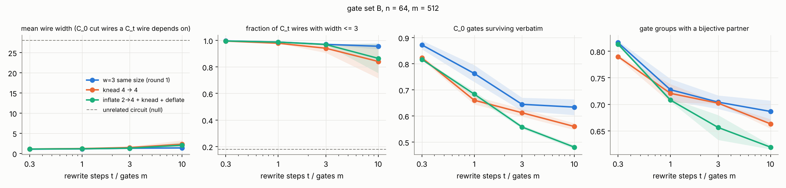
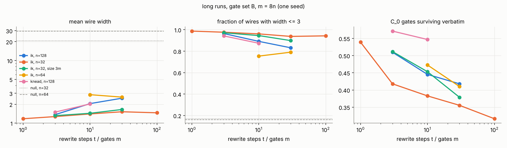

# Random geometric miters: round 2

Draft of 16 November 2026. Round 1 ([REPORT.md](REPORT.md)) found that
same-size rewriting of small windows barely changes the circuit's structure.
In this round:
- Gate set B: x_a ^= φ(x_b, x_c). Random 3-bit bijections (gate set A) were
  dropped, because their windows are rigid.
- New rewriting processes that can change the skeleton.
- A new primary statistic, the *correspondence width* between C_0 and C_t.
- A corrected weighted variant.

## Summary

1. **The new steps are much less rigid.**
   - Kneading 4 → 4 has an alternative in 88% of windows, and in 52% of
     windows it can change the skeleton (round-1 w = 3: 59% and 21%).
   - Inflating 2 → 4 always has alternatives (median 1354).
2. **The correspondence width still stays bounded.**
   - Width is the number of C_0 cut wires that a C_t wire depends on; the
     estimator detects XOR dependencies.
   - Over all processes, n and t (up to 100m), the mean wire width stays
     ≤ 3.4 (1.2–3.4 at t ≥ 10m). For unrelated circuits it is 21 (n = 32) to
     30 (n = 64).
   - At n = 32 it flattens by t ≈ 10m and stays flat up to 100m. At n = 64 it
     is the same at 10m and 30m. At n = 128 it is still rising slowly (2.05 at
     10m, 2.50 at 30m), but only up to the n = 64 level. There is no sign yet
     that the plateau grows with n.
   - Gates keep changing (only 32% of C_0's gates are left verbatim at t = 100m),
     but the correspondence to C_0 stays local.
   - Letting inflation grow C_t to 3m does not change this (width 1.65 at 30m).
3. **So the instances stay easy.** At n = 64 and 128, every round-2 miter is
   solved in ≤ 6 s by CaDiCaL, ≤ 2 s by Kissat and ≤ 1 s by ABC. Relational
   sweeping from round 1 still solves the n = 64 instances (the ones it was
   run on) in ≤ 0.5 s without the transcript.
4. **The corrected weighted variant has the intended shape.**
   - Setup: the top 5% heavy wires are never targets, so they stay inputs and
     act only as controls. Controls use a GIRG-like distance penalty (α = 4)
     and go to 25% of gates.
   - The degree tail is heavy (the heavy inputs have the largest degrees, up
     to 1460 clauses), and the formula is geometric (ρ = 0.60–0.68 against
     0.13–0.28 for the round-1 weighted model).
   - The heavy inputs are still **not a backdoor**: each of the 2^k cubes is
     as hard as the unsplit instance. Fixing the controls leaves the
     uncontrolled model, which costs CDCL just as much.
5. **Interpretation (hypothesis).** Rewriting with bounded windows seems to
   stay in a neighbourhood of C_0 whose correspondence width is O(1),
   independent of t and apparently of n. If that is true in general, Q2 and Q3
   fail for every bounded-window process. Hardness then needs windows that
   grow with n (the proposal's w = O(log n) regime) or non-local steps.

## Processes

Each step picks a convex window of w gates, as in round 1. It replaces the
window by a uniformly random *different* sequence of L gates from the same
gate set, on the window's wires, that computes the same function.

| process | step types | size of C_t |
|---|---|---|
| `w3` (round 1) | 3 → 3 | m |
| `knead` | 4 → 4, windows on ≤ 7 wires | m |
| `ik` | 50% knead 4 → 4; otherwise inflate 2 → 4 while the size is < 1.25 m, else deflate 4 → 2 if possible | ≈ 1.25 m |

**The sampler is exact.**
- Length 2 and 3: exhaustive search, as in round 1.
- Length 4: meet in the middle over all 2-gate products on the window's wires
  (`csrc/prod4*.c`). Sample a first pair r with probability ∝ the number of
  second pairs r' whose product with r equals F, then r' uniformly among them.
  This is uniform over all solutions. The kernel's counts match an independent
  Python count on test windows.

**Validation.** `check.py` passes on 22 small instances:
- B, `knead` and `ik`, n ∈ {12, 16}, t up to 2m;
- the corrected weighted variant;
- snapshot runs.

**What a step can do** (n = 64, 300 windows each; 20 samples per window are
classified):

| step | windows with an alternative | median # alternatives | windows with a new-skeleton alternative | samples: reorder / same skeleton / inserted pair / new skeleton |
|---|---|---|---|---|
| w3 (3 → 3) | 59% | 1 | 21% | 54 / 18 / 0 / 28 % |
| knead (4 → 4) | 88% | 3 | 52% | 40 / 20 / 0 / 40 % |
| inflate (2 → 4) | 100% | 1354 | 100% | 0 / 0 / 35 / 65 % |
| deflate (4 → 2), random window | 0.7% | 0 | – | – |

Cost per step: knead about 0.15 s, inflate 0.01 s, w3 0.002 s.

## Correspondence width

**Definition.**
- Fix a cut j of C_t (its first j gates) and a cut i of C_0.
- Φ_{i,j} = (C_t prefix j) ∘ (C_0 prefix i)⁻¹ is a bijection of {0,1}ⁿ.
- D_{i,j}(w) is the set of input bits that output bit w of Φ depends on. It is
  found by sensitivity: 64 random base points, each with all n single-bit
  flips. This detects XOR dependencies, which an entropy-greedy search misses.
- The **wire width** of (j, w) is min_i |D_{i,j}(w)|, over C_0 prefixes near
  the relative position of j.
- Prefixes are only some of the cuts of C_0, so this is an upper bound
  (`width.py`).
- If the width stays ≤ k, the round-1 argument gives refutations of size
  m · 2^O(k). So hardness needs k = ω(log n).

**Validation** (n = 64, m = 512, 12 cuts):

| pair | mean wire width | wires with width ≤ 3 | mean cut width |
|---|---|---|---|
| t = 0 | 1.00 | 100% | 1.00 |
| round-1 A, t = 10m (gauge only) | 1.37 | 95% | 3.1 |
| round-1 B, t = 10m | 1.65 | 91% | 3.2 |
| C_0 vs an unrelated random circuit (null) | 28.0 | 18% | 28.3 (grows with depth, up to 49) |

## Width against t



n = 64, m = 512, means over 2 seeds:

| process | t/m | mean wire width | wires with width ≤ 3 | equal/compl. signals | groups with bijective partner | gates verbatim |
|---|---|---|---|---|---|---|
| ik | 0.3 | 1.09 | 100% | 0.88 | 0.81 | 0.82 |
| ik | 1 | 1.15 | 99% | 0.80 | 0.71 | 0.68 |
| ik | 3 | 1.31 | 97% | 0.77 | 0.66 | 0.56 |
| ik | 10 | 2.04 | 86% | 0.72 | 0.62 | 0.48 |
| knead | 0.3 | 1.09 | 99% | 0.86 | 0.79 | 0.82 |
| knead | 1 | 1.21 | 98% | 0.80 | 0.72 | 0.66 |
| knead | 3 | 1.47 | 94% | 0.79 | 0.70 | 0.61 |
| knead | 10 | 2.28 | 84% | 0.75 | 0.66 | 0.56 |
| w3 | 0.3 | 1.06 | 100% | 0.88 | 0.82 | 0.87 |
| w3 | 1 | 1.14 | 99% | 0.82 | 0.73 | 0.76 |
| w3 | 3 | 1.29 | 97% | 0.80 | 0.70 | 0.64 |
| w3 | 10 | 1.36 | 96% | 0.77 | 0.69 | 0.63 |

- `knead` and `ik` widen the correspondence more than `w3`.
- The spread between seeds is large. At t = 10m, `knead` gives 3.28 (seed 0)
  and 1.28 (seed 1); `w3` gives 1.55 and 1.18. Seed 0 has wider correspondence
  for every process, so a difference between processes is suggestive but not
  established.

**Long runs** (one seed each; snapshots of one trajectory):



| n | process | t/m | size of C_t | mean wire width | wires with width ≤ 3 | max wire width | gates verbatim |
|---|---|---|---|---|---|---|---|
| 32 | ik | 1 | 320 | 1.17 | 99% | 3.6 | 0.54 |
| 32 | ik | 3 | 320 | 1.27 | 98% | 4.0 | 0.42 |
| 32 | ik | 10 | 320 | 1.40 | 96% | 4.4 | 0.38 |
| 32 | ik | 30 | 320 | 1.52 | 94% | 4.7 | 0.36 |
| 32 | ik | 100 | 320 | 1.46 | 94% | 4.8 | 0.32 |
| 32 | ik (size 3m) | 3 | 768 | 1.32 | 97% | 4.0 | 0.51 |
| 32 | ik (size 3m) | 10 | 768 | 1.43 | 95% | 4.8 | 0.45 |
| 32 | ik (size 3m) | 30 | 768 | 1.65 | 90% | 6.2 | 0.38 |
| 32 | knead | 1 | 256 | 1.12 | 99% | 3.0 | 0.55 |
| 32 | knead | 3 | 256 | 1.21 | 98% | 3.9 | 0.47 |
| 32 | knead | 10 | 256 | 1.42 | 95% | 5.0 | 0.43 |
| 32 | knead | 30 | 256 | 1.40 | 95% | 4.8 | 0.40 |
| 32 | knead | 100 | 256 | 1.39 | 96% | 4.7 | 0.34 |
| 64 | ik | 10 | 640 | 2.85 | 75% | 11.4 | 0.47 |
| 64 | ik | 30 | 640 | 2.60 | 79% | 10.3 | 0.41 |
| 64 | knead | 10 | 512 | 3.28 | 71% | 11.3 | 0.55 |
| 64 | knead | 30 | 512 | 3.36 | 73% | 12.0 | 0.52 |
| 128 | ik | 3 | 1280 | 1.36 | 96% | 6.6 | 0.51 |
| 128 | ik | 10 | 1280 | 2.05 | 89% | 10.8 | 0.45 |
| 128 | ik | 30 | 1280 | 2.50 | 83% | 12.6 | 0.42 |
| 128 | knead | 3 | 1024 | 1.50 | 94% | 8.3 | 0.57 |
| 128 | knead | 10 | 1024 | 2.02 | 87% | 10.7 | 0.55 |

Null (C_0 against an unrelated random circuit): mean wire width 20.7 (n = 32)
and 29.5 (n = 64), with 16–17% of wires at width ≤ 3.

- The width reaches a plateau. At n = 32 it is flat from 10m to 100m, for
  both `knead` and `ik`. At n = 64 it is the same at 10m and 30m.
- **No growth with n is visible, but n = 128 has not settled yet.** At
  n = 128, `ik` rises from 2.05 (t = 10m) to 2.50 (t = 30m). That is the
  level where n = 64 levelled off (2.6–2.85, seed 0). It is consistent with
  the same plateau reached more slowly, but slow continued growth is not
  ruled out; that needs t = 100m at n = 128. n = 32 sits lower, possibly a
  small-torus effect.
- Meanwhile the circuit keeps changing: gates surviving verbatim fall
  steadily, to 32% at t = 100m.
- With 3× inflation, the width rises slowly (1.32 → 1.65 from 3m to 30m),
  still far from the null.
- *Checks:*
  - The estimator gives the same values with a 4× finer search over C_0 cuts
    (3.32 vs 3.36).
  - The fingerprinted kernel reproduces the instances of the full kernel
    exactly.

## Solvers and sweeping

No process produced a hard instance. Median times (s), 300 s timeout, all
UNSAT:

| instances | CaDiCaL | Kissat | ABC `cec` | ABC `&cec` |
|---|---|---|---|---|
| n = 64, all processes, t ≤ 10m (24 instances) | 1.7–2.7 | 0.5–1.4 | 0.3–0.7 | 0.1–0.2 |
| n = 128, `knead`/`ik`, t ∈ {3m, 10m} | 3.9–6.1 | 1.4–1.8 | 0.4–1.0 | 0.2–0.3 |

- The times show no trend in t.
- Relational sweeping (round-1 `sweep.py`) solves all 24 n = 64 instances in
  ≤ 0.5 s.
- Only 52–70% of gate groups get a bijective partner, but CDCL closes the gaps
  immediately.

## Weighted variant, corrected

The round-1 weighted model is fixed as recommended there:
- Wires in the top 5% by weight are **never targets**. They remain primary
  inputs and are only read as controls, like a global mode or enable signal.
- Controls are chosen ∝ W_c · (1 + dist/r)^−4.
- Only 25% of gates are controlled.

**Degree and geometry** (n = 64, seed 0; ρ is as in round 1, after removing the
top 2% by degree):

| model | degree median | 99% | max | ρ | ρ without hubs |
|---|---|---|---|---|---|
| A_w, round 1 | 38 | 151 | 448 | 0.28 | 0.35 |
| A_w, corrected | 20 | 60 | 228 | 0.68 | 0.69 |
| B_w, round 1 (`knead`, t = m) | 16 | 64 | 92 | 0.18 | 0.19 |
| B_w, corrected (`knead`, t = m) | 16 | 64 | 280 | 0.64 | 0.66 |

- The top-degree CNF variables are now heavy inputs. In seed 0 they are
  x62 (228 clauses), x5 (204) and x6 (94); in seed 1 the top degree is 1460.
- Without hubs ρ hardly changes, because the corrected model is geometric
  even with them.

**Hardness** (median s; A_w at t = 0, B_w under `knead`):

| instances | CaDiCaL | Kissat | ABC `cec` |
|---|---|---|---|
| A_w round 1, t = 0 | 15.0 | 8.1 | 0.07 |
| A_w corrected, t = 0 | 6.8 | 3.0 | 0.06 |
| B_w round 1, t ∈ {0, m, 3m} | 0.8–1.2 | 0.4–0.5 | 0.05–0.4 |
| B_w corrected, t ∈ {0, m, 3m} | 1.3–1.8 | 0.4–1.4 | 0.05–0.3 |

**Backdoor test** (CaDiCaL; split on the top-k degree variables, which are
heavy inputs for k ≤ 3–4):

| instance | k = 0 | k = 1 | k = 2 | k = 4 | k = 6 | max cube at k = 4 |
|---|---|---|---|---|---|---|
| A_w corrected, seed 0 | 6.6 | 16.3 | 51.7 | 194.7 | 745.9 | 15.1 |
| A_w corrected, seed 1 | 6.9 | 15.6 | 44.6 | 162.7 | 645.6 | 13.2 |
| A_w round 1, seed 0 | 15.7 | 29.2 | 88.9 | 150.4 | 900.0 | 19.0 |

(total time over all cubes, in seconds)

- Each cube is about as hard as the whole instance, so the total grows like
  2^k.
- This matches the expectation "k controls cost at most 2^k", but there is no
  gain. Once the controls are fixed, what remains is the uncontrolled A model,
  and that already costs CDCL several seconds at n = 64.
- So in this model the heavy controls are not what makes the instances hard.
- Cubes ran 4 in parallel, partly alongside other jobs, so per-cube times are
  somewhat inflated.

## Conclusions and next steps

**The central finding of round 2:** making the rewriting step richer, with
4-gate kneading, inflation, deflation and larger circuits, changes C_t's gates
but not the *locality* of its correspondence with C_0. The width plateaus
at O(1), apparently independent of t and of n. As long as that holds, the
round-1 argument gives refutations of size m · 2^O(1). Every instance stays
easy, and the explanation can be recovered without the transcript.

**A hypothesis worth stating in the proposal.** For any rewriting process
whose steps act on windows of ≤ w gates, the correspondence width of C_t stays
bounded by a function of w alone, whatever t and n are.
- Each step is a local re-synthesis.
- Composing local re-syntheses would only create wide correspondences if steps
  kept enlarging each other's supports. In a random walk, they seem to reach
  an equilibrium instead.
- A proof would turn round 1 and round 2 into a theorem: no bounded-window
  local rewriting gives hardness (Q2), or hardness of recovery (Q3).
- This would be a clean negative answer to a question close to ARC's: for
  local rewriting, recording the explanation is not needed.

**Next steps, if the project continues:**
1. **Plateau width against window size w.** The data so far are suggestive
   but noisy (w = 3 against w = 4 depends on the seed). If the plateau grows
   with w, then w = Θ(log n) (the proposal's regime) or larger might push the
   width past log n. That needs a sampler for 5–6-gate windows, e.g. 2 + 3
   meet in the middle on ≤ 6 wires.
2. **Theory for the plateau:** prove that bounded-window random rewriting keeps
   the correspondence width bounded, at least for gauge-type moves (round 1)
   and then for kneading.
3. **Non-local rewriting steps.** For example, conjugating a whole slab of
   the circuit by a random local circuit, or windows chosen along a long path.
   These test whether non-locality is what is missing.
4. Keep the corrected weighted variant as the realism axis. Drop the backdoor
   question unless a hard base model is found.

**Limits of round 2:**
- One or two seeds per setting, and large seed-to-seed spread.
- n ≤ 128.
- Gate set B only.
- The width estimator is an upper bound over prefix cuts.
- A at larger windows was not tested; exhaustive search is infeasible in
  Python. The counting argument from round 1 predicts it stays rigid.

## Reproduce

```bash
python3 r2_richness.py 300                                      # step richness
python3 r2_gen.py grids/r2_e0.json results/instances/r2e0       # validation instances
for f in results/instances/r2e0/*.json; do python3 check.py $f --solver; done
python3 r2_gen.py grids/r2_main.json results/instances/r2       # n = 64 grid (sampler "full")
python3 r2_gen.py grids/r2_long.json results/instances/r2long   # long runs with snapshots
python3 r2_gen.py grids/r2_weighted.json results/instances/r2w  # weighted variant
python3 r2_analyze.py results/instances/r2 results/r2_width.csv  # width + survival
python3 run.py solve results/instances/r2 results/r2_e3.csv 300 cadical,kissat,abc_cec,abc_gcec
python3 e4_sweep.py results/instances/r2 results/r2_sweep.csv
```
