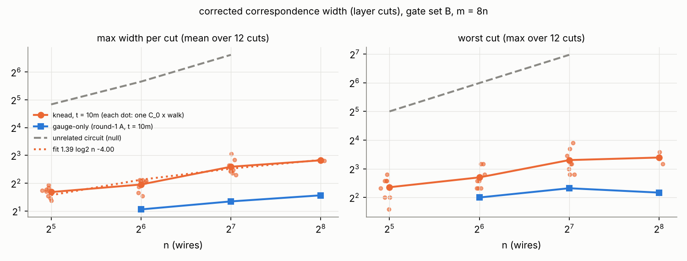
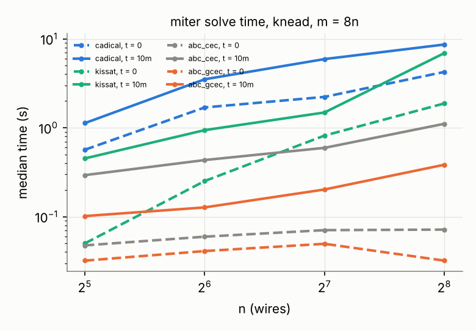

# Random geometric miters: round 3

Draft of 17 November 2026. Round 3 acts on an external review of rounds 1–2.
The review is summarised in the plan; theory is in [THEORY.md](THEORY.md).

## 0. Correction to round 2

Round 2 claimed that the correspondence width "plateaus at O(1)". That claim
used `wire_mean`, a per-wire minimum over *different* C_0 cuts, which no single
cut realises. A proof needs the maximum over wires at one cut. The prefix-cut
version of that maximum (`cut_max_max` in `results/r2_long_width.csv`) grew
with n: 8–15, 18–20 and 29–32 at n = 32, 64, 128. The reviewer was right that
the round-2 statistic hid this.

Round 3 shows that most of that growth was an artifact of the estimator:
- Prefix cuts in sequence order drift out of alignment when commuting gates
  are reordered.
- With cuts at ASAP layers of the dependency DAG, the maximum is much smaller.
  The calibration controls pass (section A).
- What remains is a slow growth with n, roughly log₂ n (section B).

**Round 3 in brief.**
- **A.** The corrected width estimator (layer cuts, maximum over wires)
  passes every calibration control.
- **B.** With it, the width after kneading grows about like 1.4·log₂ n over
  n = 32–256 (26 instances). A power n^0.43 fits as well. Solvers and
  transcript-free sweeping solve n = 256 in under 10 s.
- **C.** Planted R·R⁻¹ makes C_t wide relative to C_0, but not hard.
  Inflating to 3m and 5m adds about 2–3 to the width, and nothing to the
  hardness.
- **C2.** Geometry noise freezes the long-range gates, so kneading becomes
  more rigid, not less. Weighted gate arity failed its gate-first check.
- **Decision.** Stop experimenting with bounded-window local rewriting. What
  remains is a theorem to prove, or a different rewriting process (see
  "Decisions and next steps").

## A. Corrected width estimator and calibration

The new estimator is `width.width_layers`:
- Both circuits are layered as early as possible (ASAP), with the commutation
  rule used by the rewriting. Cuts are taken at layer boundaries, which are
  invariant under commuting reorders.
- For each of 12 C_t layer cuts, the C_0 layer cut within ±12% of the relative
  position (at least ±3 layers) that minimises the maximum over wires of |D(w)|
  is chosen.
- Reported: that maximum (`cut_max`), its mean and maximum over the 12 cuts,
  and the mean over wires.
- Sensitivity sampling uses P = 256 base points, each with all n single-bit
  flips.

Calibration (`r3_calibrate.py` → `results/r3_calibration.csv`):

| control | max width per cut: mean over 12 cuts / worst cut | expected |
|---|---|---|
| t = 0 (n = 64) | 1.00 / 1 | 1 |
| C_0 vs a random commuting reordering, n = 64 and n = 128 | 1.00 / 1 | 1 |
| round-1 A, gauge-only, t = 10m, n = 64 (2 seeds) | 2.25, 1.92 / 5, 3 | ≤ 3, up to about 5 at the 2% skeleton changes |
| same, n = 128 | 2.25, 2.83 / 3, 7 | flat in n |
| same, n = 256 | 2.83, 3.08 / 3, 6 | flat in n |
| null: C_0 vs an unrelated circuit, n = 32 / 64 / 128 (2 seeds) | 28.5 / 50.4 / 98.2; worst cut ≈ n | baseline |
| P = 64 vs 1024 (knead, n = 64, t = 30m) | 4.17 / 6 for both | equal |
| P = 64 vs 1024 (null, n = 64) | 46.5 vs 47.8 | equal |

The gauge-only control stays at about 2–3 for n = 64 to 256. The rare
skeleton changes give occasional cuts up to 5–7.

**Round-2 instances, re-analysed** (`results/r3_width.csv`; mean over the 12
cuts of the max width per cut; worst cut in parentheses; one or two seeds):

| n | w3 (t = 10m) | knead (t ≥ 3m) | ik (t ≥ 3m) | null |
|---|---|---|---|---|
| 32 | – | 3.7–4.1 (8) | 3.8–4.7 (7) | 28.5 |
| 64 | 4.2 (7) | 4.2–5.1 (11) | 4.8–5.7 (10) | 50.4 |
| 128 | – | 5.3–6.6 (10) | 5.8–7.8 (13) | 98.2 |

For comparison, the old prefix statistic gave 20 at n = 64 and 32 at n = 128.

## B. Width against n with seeds

**Result: the corrected width grows about like 1.4·log₂ n from n = 32 to
256. The miters stay easy: at n = 256 the best tool needs 0.4 s, and
transcript-free sweeping needs 3.7 s.**

Setup (`grids/r3_B.json`, `grids/r3_B256.json`): knead, gate set B, m = 8n,
t = 10m.
- n ∈ {32, 64, 128}: 4 C_0 seeds × 2 walk seeds.
- n = 256: 2 C_0 seeds × 1 walk seed (generation took 39–56 min each).
- Width is measured with `width.width_layers` (`results/r3_B_width.csv`).

| n | instances | max width per cut (mean over 12 cuts), mean ± sd | worst cut: mean / max | mean width over wires | null (unrelated circuit) |
|---|---|---|---|---|---|
| 32 | 8 | 3.21 ± 0.43 | 5.1 / 7 | 1.23 | 28.5 |
| 64 | 8 | 3.88 ± 0.56 | 6.5 / 9 | 1.25 | 50.4 |
| 128 | 8 | 6.03 ± 1.17 | 9.9 / 15 | 1.36 | 98.2 |
| 256 | 2 | 7.08 ± 0.12 | 10.5 / 12 | 1.43 | – |

**Log or power?**
- Fits over all 26 instances:
  - 1.39·log₂ n − 4.0 (squared error 16.1);
  - 0.70·n^0.43 (squared error 15.8).
- Fitted on n ≤ 128 alone, the two predict 7.2 (log) and 7.8 (power) at
  n = 256. The observed mean is 7.1.
- The n = 256 point sits closer to the log curve. But the standard error of a
  2-instance mean is about 0.8 at this spread, so the data do not separate
  the two forms.
- Most of the spread comes from the walk, not from C_0. At n = 128 the sd
  between the two walks of one C_0 is 1.13, against 0.64 between the C_0.
- The mean over wires barely moves (1.23 → 1.43), so the growth comes from a
  few wires per cut.

TAIL_TEXT

**Solvers and sweeping on the same instances, with t = 0 baselines**
(`results/r3_B_e3.csv`, `results/r3_B_sweep.csv`; medians, 300 s timeout, all
UNSAT):

| n | t | CaDiCaL | Kissat | ABC `cec` | ABC `&cec` | sweeping | gate groups verified by sweeping |
|---|---|---|---|---|---|---|---|
| 32 | 0 | 0.57 | 0.05 | 0.05 | 0.03 | 0.08 | 100% |
| 32 | 10m | 1.13 | 0.45 | 0.29 | 0.10 | 0.10 | 62% |
| 64 | 0 | 1.69 | 0.25 | 0.06 | 0.04 | 0.26 | 100% |
| 64 | 10m | 3.51 | 0.94 | 0.43 | 0.13 | 0.26 | 63% |
| 128 | 0 | 2.22 | 0.82 | 0.07 | 0.05 | 1.19 | 100% |
| 128 | 10m | 5.92 | 1.48 | 0.59 | 0.20 | 1.03 | 68% |
| 256 | 0 | 4.24 | 1.88 | 0.07 | 0.03 | 5.51 | 100% |
| 256 | 10m | 8.63 | 6.91 | 1.11 | 0.38 | 3.65 | 66% |

- **CaDiCaL:** the ratio of t = 10m to t = 0 stays at 2.0–2.7 for all n.
- **ABC:** the ratio grows (`cec` 6 → 16), but only because ABC solves
  C_0 = C_0 by structural hashing in constant time. Its t = 10m time grows
  sublinearly in the circuit size (1.1 ms per gate at n = 32, 0.5 ms per gate
  at n = 256).
- **Sweeping:** it never sees the transcript, verifies relations for about
  two thirds of the gate groups at every n, and finishes in seconds.
- **Reading:** width about log n is what the section-4 sketch of
  [THEORY.md](THEORY.md) turns into refutations of size m·2^O(log n), i.e.
  polynomial. The solver times are consistent with that. The power fit
  cannot be excluded from width data alone, but nothing in the solver times
  hints at it.

## C. Real inflation and planted R·R⁻¹

**Result: nothing is hard. Planted structure makes C_t wide relative to C_0
but not hard. Real inflation raises the width by about 2–3, not the solver
time.**

Setup (`grids/r3_C_stage1.json`; n = 64, m = 8n, seeds 30 and 31):
- **Planted R·R⁻¹** (`plant_mult` 1 and 4): a random local circuit R of size
  n or 4n, with its inverse, is inserted at position m/2 of C_0. Kneading
  then runs for t ∈ {0, m, 10m}.
- **ikfree** (`size_mult` 3 and 5): while the circuit is below the size
  target, a step inflates (2 → 4 gates) with probability 1/2, otherwise it
  kneads. There is no deflation. The targets are reached by t = 10m.
- Every new type (planted, ikfree, both noise arms, p = 1) passed
  `check.py --solver` at n = 16 (`results/instances/r3val`).

Results, mean over the 2 seeds (`results/r3_C_width.csv`, `r3_C_e3.csv`,
`r3_C_sweep.csv`):

| variant | t | gates in C_t | max width per cut: mean / worst | best tool (s) | CaDiCaL (s) | sweeping (s) |
|---|---|---|---|---|---|---|
| knead (baseline) | 0 | 512 | 1.0 / 1 | 0.03 | 1.4 | 0.30 |
| knead (baseline) | 10m | 512 | 5.5 / 10 | 0.13 | 2.7 | 0.30 |
| planted, \|R\| = n | 0 | 640 | 5.9 / 13 | 0.14 | 1.4 | 0.34 |
| planted, \|R\| = n | 10m | 640 | 6.2 / 10 | 0.14 | 2.1 | 0.31 |
| planted, \|R\| = 4n | 0 | 1024 | 16.3 / 37 | 0.20 | 1.8 | 1.10 |
| planted, \|R\| = 4n | 10m | 1024 | 16.2 / 32 | 0.30 | 3.3 | 5.23 |
| ikfree to 3m | 10m | 1536 | 7.3 / 12 | 0.42 | 9.0 | 0.76 |
| ikfree to 5m | 10m | 2560 | 8.4 / 15 | 0.86 | 7.9 | 1.32 |

All 52 miters are UNSAT for all four tools, and sweeping solves every one.
- **Planted:**
  - The width *to C_0* jumps at t = 0 (16 at |R| = 4n) and stays there. This
    is the predicted effect: R·R⁻¹ has no counterpart in C_0.
  - Yet the miter is as easy as the baseline. The solvers and sweeping find
    the mirror relations inside R·R⁻¹, and kneading for 10m does not hide
    them. Sweeping does slow from 1.1 s to 5.2 s at |R| = 4n, and then only
    35% of C_t's gate groups receive a verified relation. The final CDCL call
    still closes the rest in 0.1 s.
  - So width to C_0 is one proof route, not a hardness measure. The plan
    disagreed with the reviewer on exactly this point.
- **ikfree:**
  - The width rises by about 2–3 over plain kneading (7.3 and 8.4 against
    5.5), and the circuit grows 3–5 times.
  - The solver times grow roughly with size: CaDiCaL 2.7 s → 8–9 s,
    ABC `&cec` 0.13 → 0.4–0.9 s.
  - Sweeping verifies only 20–24% of the gate groups, yet still finishes in
    ≤ 1.3 s.
- **Decision:** the plan's gate for n = 128 was a best tool above 300 s while
  t = 0 stays under 10 s. Every best-tool time here is below 1 s, so stage 2
  was not run.

## C2. Geometry noise and weighted gate arity

**Arm (iii), weighted gate arity: killed by the gate-first check.**
- Setup (`r3_toffoli_check.py` → `results/r3_toffoli_check.json`):
  - circuits with 25% heavy gates x_a ^= AND of 3 literals, where the third
    control comes from the long-range kernel;
  - 300 knead windows containing a heavy gate;
  - all equivalent 4-gate sequences over B gates plus 3-control Toffoli gates
    on the window's wires.
- Results:
  - 89% of windows have an alternative;
  - only **39%** have a new-skeleton alternative, against 52% for plain B;
  - only 18% of heavy windows fit the 7-wire cap;
  - 0.8 s per window.
- Heavy AND gates make windows *more* rigid, not less. An AND of 3 literals
  fires on 1/8 of inputs and has few equivalent rewritings. By the plan's rule
  this arm is dropped.

**Arms (i)/(ii), geometry noise: no effect beyond the c = 0 baseline. Long
gates freeze, so noise makes the circuits *more* rigid. Dropped in this form.**

Setup (same stage-1 grid; n = 64, seeds 30 and 31, knead to t = 10m):
- A gate is long-range with probability p = c · n^(−1/d) · n/m, for
  c ∈ {0.5, 2, 8}.
  - Its wires come from the power-law distance kernel (exponent 2.5).
  - p = 1 (`c999`) is the expander control.
- **Arm L** (local): replacement gates must be local.
- **Arm A** (allowed): replacements may also use any wire pair that a long
  gate of C_0 uses (`Geometry.extra_pairs`).
  - This is narrower than the plan's "any pair the kernel allows". The
    4-gate sampler enumerates gates on the window's wires and keeps only
    triples whose pairs are all allowed. Admitting every kernel pair would
    turn each window into an all-pairs gate set.

| c | long gates in C_0 | arm | width at 10m: mean / worst | C_0 gates surviving: local / long | best tool t = 0 → 10m (s) | Kissat t = 0 → 10m (s) | CaDiCaL t = 0 → 10m (s) |
|---|---|---|---|---|---|---|---|
| 0 | 0 | – | 5.5 / 10 | 0.52 / – | 0.03 → 0.13 | 0.26 → 0.56 | 1.4 → 2.7 |
| 0.5 | 0–2 | L | 4.5 / 9 | 0.52 / 1.00 | 0.04 → 0.11 | 0.17 → 1.62 | 1.4 → 3.1 |
| 0.5 | 0–2 | A | 4.5 / 9 | 0.51 / 1.00 | 0.04 → 0.12 | 0.18 → 1.14 | 1.4 → 4.3 |
| 2 | 12–13 | L | 4.5 / 8 | 0.59 / 1.00 | 0.04 → 0.11 | 0.29 → 0.87 | 1.9 → 2.4 |
| 2 | 12–13 | A | 4.5 / 9 | 0.51 / 0.68 | 0.03 → 0.13 | 0.32 → 1.04 | 1.9 → 2.9 |
| 8 | 57–62 | L | 3.8 / 9 | 0.66 / 1.00 | 0.04 → 0.10 | 0.23 → 0.64 | 0.7 → 1.6 |
| 8 | 57–62 | A | 3.8 / 7 | 0.61 / 0.78 | 0.04 → 0.11 | 0.26 → 0.68 | 0.8 → 2.1 |
| p = 1 | 470–472 | A | 1.2 / 3 | 0.92 / 0.97 | 0.04 → 0.07 | 0.36 → 0.29 | 1.3 → 1.0 |

(Gate survival comes from the instance files, using `Geometry.adj` for
locality.)

What happens:
- **Long gates are frozen anchors.**
  - In arm L they survive 100% by construction.
  - In arm A they survive 68–78%, against about 50% for local gates.
- **They also protect their neighbourhood.** Local gate survival rises from
  0.52 (c = 0) to 0.61–0.66 at c = 8. A window that touches a long gate
  spans more wires; it often exceeds the 7-wire cap or has no
  alternative over allowed triples.
- **The width does not rise with c.** It drifts down from 4.5 (c = 0.5) to
  3.8 (c = 8). The step from c = 0 to c = 0.5 (5.5 → 4.5) involves almost no
  long gates. The C_0 differ because the geometry draws differ, so that step
  shows the seed-to-seed noise of about 1.
- **At p = 1 kneading does nothing at all** (97% survival, width 1.2). The
  expander control is not hard at t = 0 either (best tool 0.04 s at n = 64).
- **The solver ratio t = 10m / t = 0 is the same with and without noise.**
  It is 3–4× for the best tool and 1–3× for CaDiCaL, all at sub-second to
  few-second times. Kissat ratios scatter from 2× to 13× at times below 2 s,
  which is preprocessing noise.

**Decision.**
- The keep rule needed above 10× growing with n; the kill rule needed under
  3× everywhere. Neither fires cleanly, because the best-tool ratio sits at
  3–4×. But the ratio does not depend on c, so whatever there is comes from
  kneading, not from the noise.
- The arm is dropped as implemented. Stage 2 at n = 128 was not run.
- The obstruction is mechanical. Bounded windows with a wire cap cannot
  rewrite around long gates. A GIRG-style model would need a rewriting
  process that is itself non-local: windows taken in the circuit's own
  interaction graph, with a wire cap that grows with the gates' range. That
  needs a sampler beyond the current 7-wire, 4-gate limit.

## Decisions and next steps

| step | plan rule | outcome | decision |
|---|---|---|---|
| A, estimator | the controls must pass | all pass | layer-cut max width is the statistic from now on |
| B, scaling | growth ≥ log n keeps Q2 alive; then run solvers on n = 256 | ≈ 1.4·log₂ n; n = 256 solved in 0.4 s (best tool) and 3.7 s (sweeping) | width sits at the log boundary, where the proof sketch gives polynomial refutations; no sign of hardness |
| C, planted and ikfree | best tool above 300 s at n = 128 | below 1 s at n = 64 | stage 2 not run; negative |
| C2 (i)/(ii), geometry noise | ratio above 10× and growing with n | 3–4×, the same as without noise | dropped as implemented |
| C2 (iii), gate arity | new-skeleton fraction above 52% | 39% | dropped |

**Recommendation: stop experimenting with this model family.** That is
local gate sets A/B with windows of ≤ 4 gates and ≤ 7 wires, with or without
geometry noise, planted R·R⁻¹ or inflation to 5m.
- Over three rounds, every variant was solved in seconds without the
  transcript.
- The one statistic that grew with n grows like log n, which is what a
  polynomial-size proof needs.
- More seeds, larger t or larger n within this family are unlikely to change
  that.

**What is worth doing next**, in order of value:
1. **Prove the negative result** ([THEORY.md](THEORY.md), section 5). Show
   that bounded-window local rewriting keeps the correspondence width at
   O_w(log n) for every t, or directly that relational sweeping finds
   polynomial refutations. This is the most solid output of rounds 1–3. The
   per-wire tail measured in section B is the empirical handle for it.
2. **If the hardness conjecture is to be pursued, change the process, not its
   parameters.** The rewriting must reach beyond bounded local windows.
   Candidates:
   - windows of w = Θ(log n) gates;
   - rewriting in the circuit's own interaction graph, which the GIRG idea
     needs, because long gates freeze under local windows (C2);
   - a gate set with exponentially many identities per window.

   Each needs a sampler beyond 4 gates and 7 wires, so it is a new project
   rather than another round.
3. **Literature (E), still blocked.** PDFs of the CCMR paper (eprint
   2024/006) and its follow-ups would show which gate sets and window sizes
   they use, and whether they test against SAT solvers or sweeping. That
   would show whether direction 2 has already been explored.
